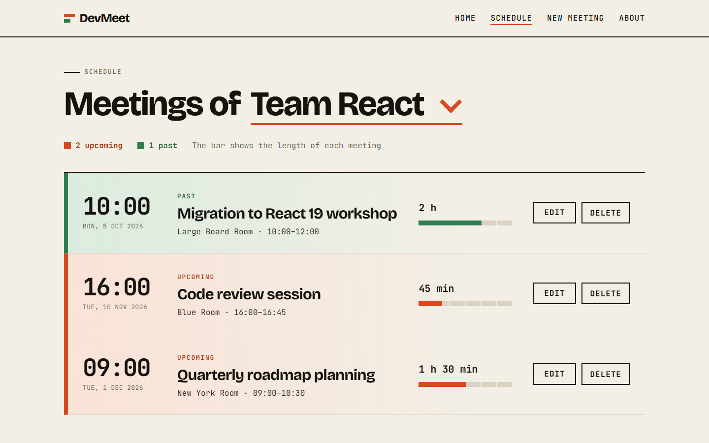
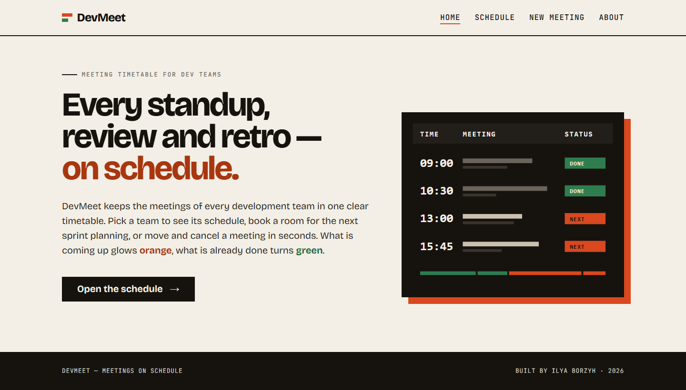
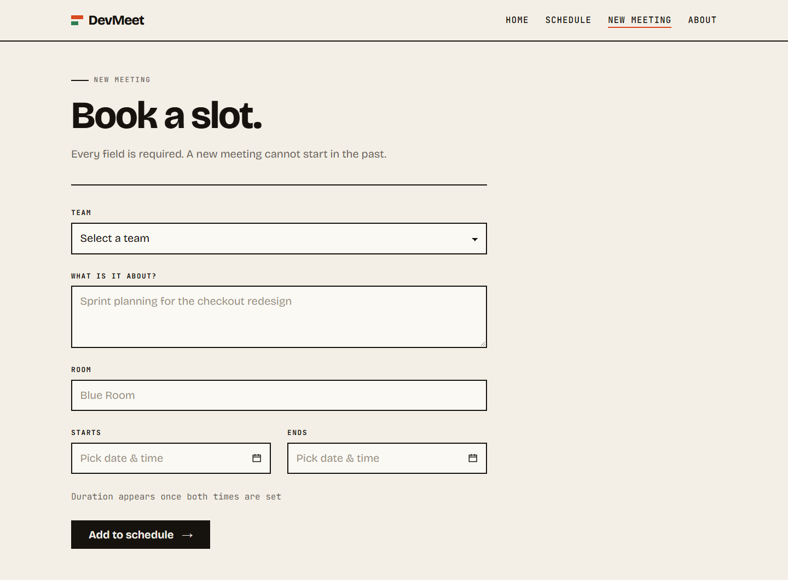
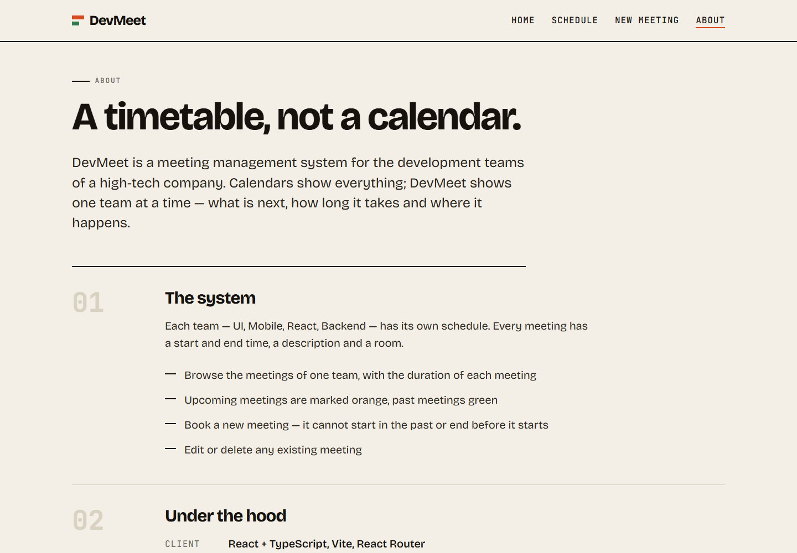
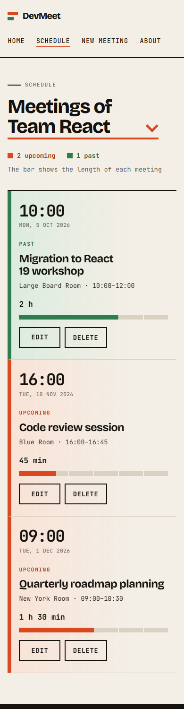

# DevMeet

A full-stack app for managing the meetings of development teams in a high-tech company. Pick a team to see its timetable, book a new meeting, and edit or delete existing ones.

- **Server:** Node.js + TypeScript + Express, RESTful API
- **Database:** PostgreSQL on [Neon](https://neon.tech)
- **Client:** React + TypeScript (Vite), React Router

## Screenshots

**A team's timetable.** Upcoming meetings are orange, past ones are green. The bar next to each meeting shows how long it is.



| Home | Add meeting |
|---|---|
|  |  |

| About | Phone |
|---|---|
|  |  |

## Features

- **Home page:** a short intro to the system with an illustration.
- **About page:** a description of the system, the technologies used, and the developer's details.
- **Schedule page:** pick a team from a Select that is loaded from the server. The page then shows only that team's meetings, sorted by start time:
  - start time, date, description, room, and the calculated duration (for example `1 h 30 min`), shown as text and as a bar
  - **orange** for meetings that start in the future, **green** for meetings that started in the past
  - each meeting has an **Edit** button and a **Delete** button (Delete asks for confirmation)
- **Add meeting:** a form with validation:
  - all fields are required
  - the start time cannot be in the past
  - the end time must be after the start time
  - after saving, the schedule of that team opens with the new meeting in it
- **Edit meeting:** the form opens with the current values filled in. Past meetings can be edited, but the end time must still be after the start time.
- **Validation on both sides:** the client checks the form before sending, and the server checks the same rules again.
- **Error handling:** each field shows its own error message, and API errors are shown to the user.
- **Mobile friendly:** on phones the timetable becomes a single column with large touch targets.

## Project structure

```
DevMeet/
├── database/
│   └── devmeet.sql             # Creates the tables and inserts sample data
├── Backend/                    # Express API
│   ├── src/
│   │   ├── app.ts              # Express app and startup
│   │   ├── db/connect.ts       # Neon connection
│   │   ├── types/              # Team, Meeting
│   │   ├── controllers/        # SQL queries and validation
│   │   └── routes/             # /api/teams, /api/meetings
│   └── .env.example
├── Frontend/                   # React app
│   └── src/
│       ├── pages/              # Home, About, Meetings, Add/Edit meeting
│       ├── components/         # MeetingForm, DateTimeField
│       ├── api.ts              # fetch calls to the backend
│       ├── types.ts            # TypeScript interfaces
│       └── utils/format.ts     # date, duration and status helpers
└── docs/screenshots/
```

## Data model

| Table | Column | Type | Notes |
|---|---|---|---|
| `teams` | `team_id` | `SERIAL` | Team code (primary key) |
| | `team_name` | `VARCHAR(50)` | e.g. `Team UI`, `Team Mobile` |
| `meetings` | `meeting_id` | `SERIAL` | Meeting code (primary key) |
| | `team_id` | `INT` → `teams` | Foreign key to the team |
| | `start_time` | `TIMESTAMP` | Start date and time, in one field |
| | `end_time` | `TIMESTAMP` | End date and time, in one field |
| | `description` | `TEXT` | |
| | `room` | `VARCHAR(50)` | e.g. `Blue Room` |

All columns are `NOT NULL`. A `CHECK (end_time > start_time)` constraint stops the database from saving a meeting that ends before it starts.

## Getting started

### Prerequisites

- Node.js 22 or newer
- A free [Neon](https://neon.tech) account (PostgreSQL in the cloud)

### 1. Database

1. Create a project in Neon.
2. Open the **SQL Editor**, paste the whole content of [`database/devmeet.sql`](database/devmeet.sql) and click **Run**. This creates both tables and adds 4 teams and 10 sample meetings.
3. On the project page, click **Connect** and copy the connection string.

### 2. Server

```bash
cd Backend
npm install
cp .env.example .env    # then paste your Neon connection string
npm run dev
```

`.env`:

```
DATABASE_URL=postgresql://<user>:<password>@<host>.neon.tech/neondb?sslmode=verify-full
PORT=3000
```

When the server is ready, the console shows `Server running on http://localhost:3000`. The `.env` file is in `.gitignore`, so the password never reaches GitHub.

### 3. Client

Run the client in a second terminal, and keep the server running:

```bash
cd Frontend
npm install
npm run dev
```

Open the URL Vite prints (usually http://localhost:5173). The Vite dev server proxies `/api` requests to `http://localhost:3000`, so you don't need to set an API URL.

## API

Base URL: `http://localhost:3000/api`

| Method | Endpoint | Description |
|---|---|---|
| GET | `/teams` | All development teams |
| GET | `/meetings/by-team/:teamId` | All meetings of one team, sorted by start time |
| GET | `/meetings/:id` | One meeting |
| POST | `/meetings` | Create a meeting |
| PUT | `/meetings/:id` | Update a meeting (all fields are required) |
| DELETE | `/meetings/:id` | Delete a meeting |

Example request body for `POST /meetings` and `PUT /meetings/:id`:

```json
{
  "team_id": 1,
  "start_time": "2027-01-15T10:00",
  "end_time": "2027-01-15T11:30",
  "description": "Sprint planning",
  "room": "Blue Room"
}
```

Times are sent as local time (`YYYY-MM-DDTHH:mm`), because the `TIMESTAMP` columns have no time zone.

Validation rules:

| Request | Status | Message |
|---|---|---|
| Missing fields (`POST` and `PUT`) | `400` | `All fields are required` |
| Start time in the past (`POST` only) | `400` | `Start time cannot be in the past` |
| End time not after start time (`POST` and `PUT`) | `400` | `End time must be after start time` |
| Meeting not found | `404` | `Meeting not found` |

Error responses have the form `{ "error": "..." }`.

All six routes were tested in Postman.

## Author

**Ilya Borzyh** — [ilyaborzyh666@gmail.com](mailto:ilyaborzyh666@gmail.com) · [github.com/ilyaborz23](https://github.com/ilyaborz23)
